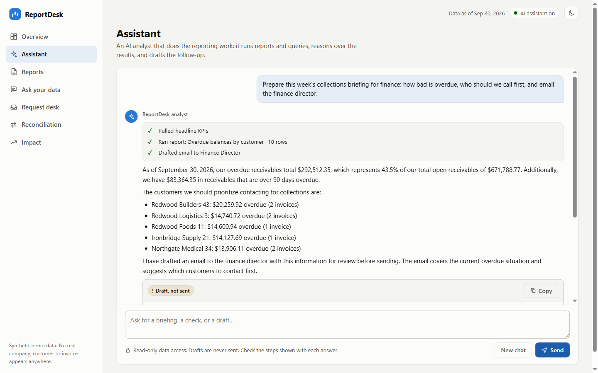
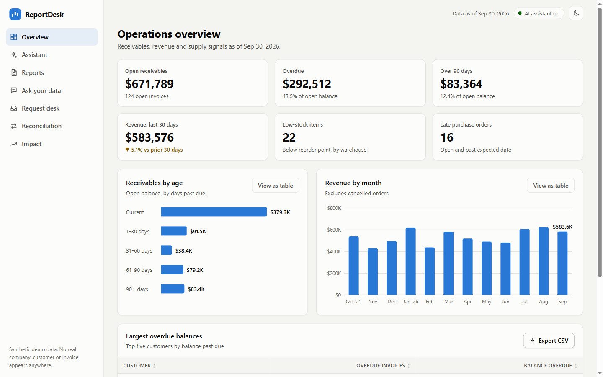
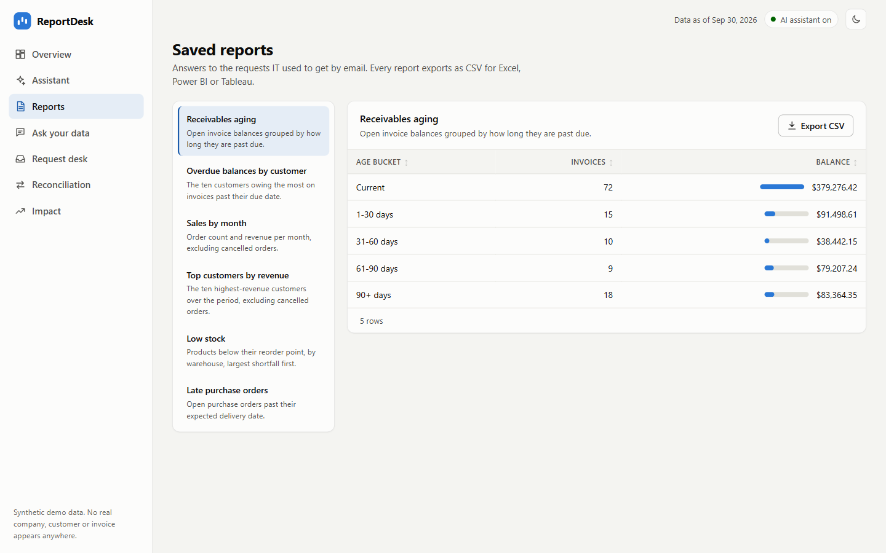
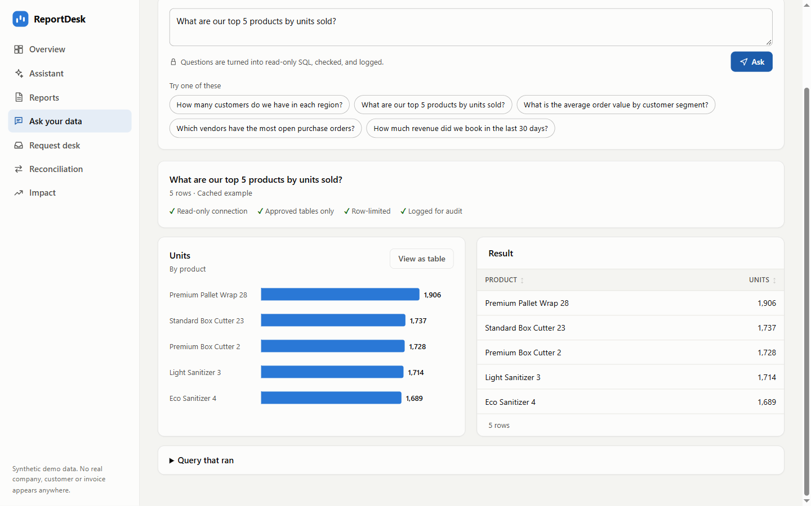
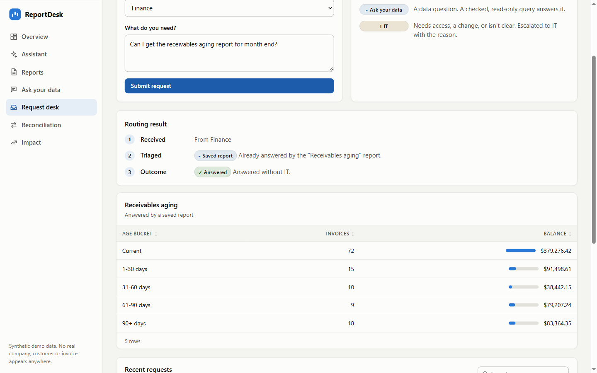
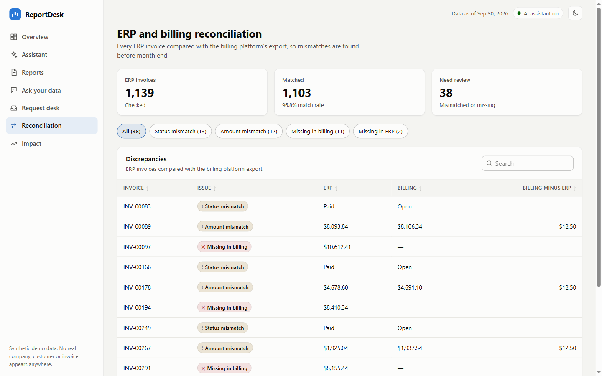
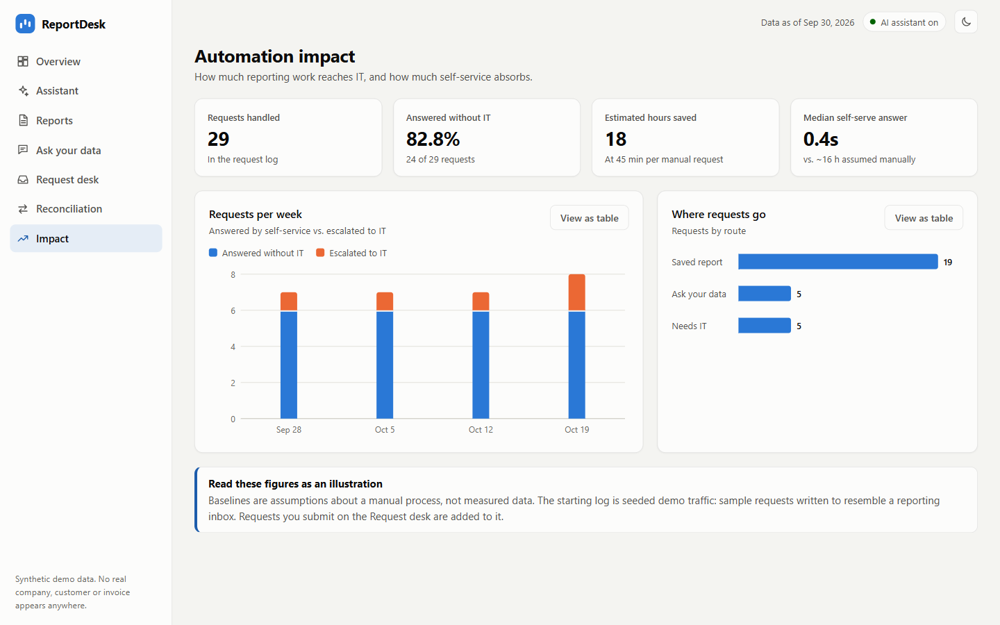
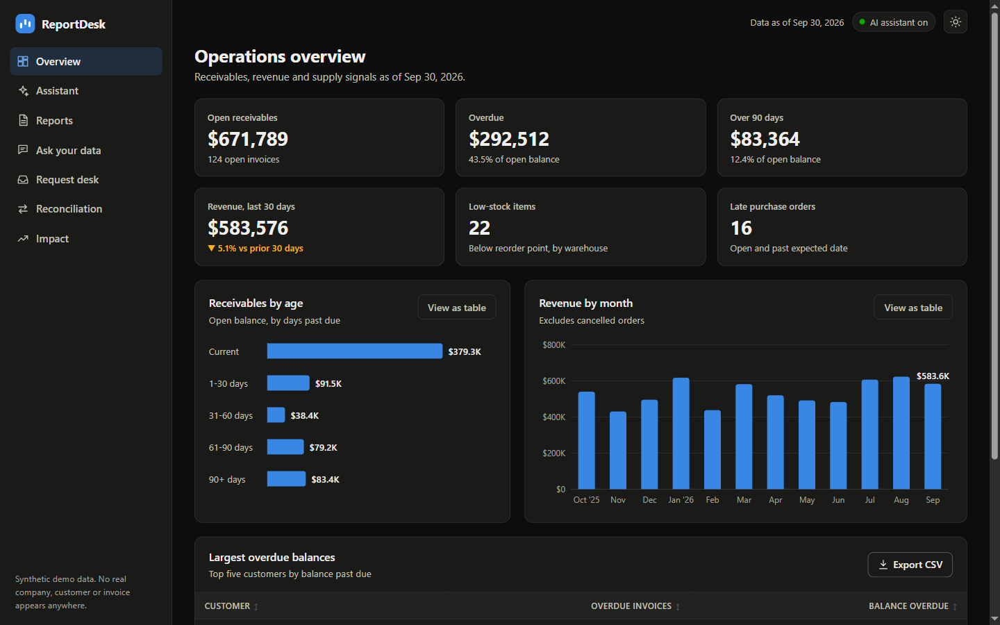

# ReportDesk

AI-assisted reporting automation for a business whose reporting requests all land on IT.

**Live demo: [reportdesk.thegoodb0rg.workers.dev](https://reportdesk.thegoodb0rg.workers.dev/?ref=github)** (no sign-up, runs on Cloudflare Workers and D1)

A department asks for a number or a briefing. Instead of a ticket, an **AI analyst** runs the right reports and queries, reads the results, and writes the answer, including a draft email for a person to review. Simpler requests are **triaged** to a saved report or a guarded natural-language query, reports run **on a schedule**, and a **reconciliation** compares the ERP with a second system.

> Everything runs on **synthetic data** (a generated mock ERP). No real company, customer or invoice appears anywhere.


*48-second walkthrough, sped up 1.5x. The full recording, [`docs/video/walkthrough.mp4`](docs/video/walkthrough.mp4), is 72 seconds and includes the live model's thinking time.*

## Try it

Open the [live demo](https://reportdesk.thegoodb0rg.workers.dev) and start with **Assistant**: click "Collections briefing" and watch it pull KPIs, run a report, write the briefing, and draft an email marked "Draft, not sent". Then try **Ask your data** with your own question, the **Request desk**, and **Reconciliation**.

Reports, the example questions and reconciliation are unlimited. Free-form AI calls are capped per visitor per day (and overall) so the demo stays free to run; if you reach the cap, you are told so, and everything else keeps working. Requests you submit are answered but never stored.

## Using this at your company? Let's talk.

Connecting it to your ERP, your reports and your own definitions is the real work. I can adapt it to fit: **[my portfolio](https://thegoodb0rg.pages.dev/?ref=reportdesk-github)**.

## The assistant



Ask for a briefing, a check, or a draft. The model decides which tools to call, in what order, and writes the answer from what comes back. Every step it took is shown with the answer, and any SQL it wrote is one click away.

| Tool the model can call | What it does |
|---|---|
| `get_kpis` | Headline receivables, revenue, stock and purchasing numbers |
| `run_saved_report` | Runs one of the six saved reports |
| `run_sql` | Runs a read-only query for anything the reports do not cover, after the SQL guard |
| `check_reconciliation` | Compares every ERP invoice with the billing export |
| `draft_email` | Writes a draft. **It cannot send anything.** A person reviews and sends |

That is the whole list. No tool writes to the ERP or sends a message, by design. See [`docs/assistant-design.md`](docs/assistant-design.md).

## Screenshots

**Overview.** Headline receivables, revenue and supply KPIs, each linking to the report behind it.


**Saved reports.** Sortable, searchable, paginated tables with currency formatting, data bars and CSV export for Excel, Power BI or Tableau.


**Ask your data.** A plain-English question becomes a checked, read-only query. The SQL that ran is one click away.


**Request desk.** Each request is triaged to a report, a generated query, or IT, with the reasoning shown.


**Reconciliation.** ERP invoices compared with the billing export, filterable by issue type.


**Impact.** Self-service vs. IT load, with the assumptions stated on the page.


**Dark theme.**


Charts follow a colour palette validated for colour-blind readers, every chart has a "View as table" twin, and the interface is built for keyboard use: skip link, visible focus, labelled controls, tables with announced sort state.

## How it fits together

```
 Request ──► Assistant (tool-calling) ──► reports / guarded SQL / reconciliation ──► briefing + draft email
        └──► Triage ─► Saved report | Ask your data | Escalate to IT (with a reason, logged)

 Schedule (GitHub Actions) ─► all reports + reconciliation ─► digest (artifact / Slack)
```

## What it demonstrates

| A reporting-automation role needs | Where it is here |
|---|---|
| Hands-on AI that connects to the ERP, database and reporting tools | `src/assistant` (tool-calling analyst), `src/ask` (text to SQL), `src/llm` (OpenRouter), CSV export for BI tools |
| Automated workflows that reduce manual reporting | `scripts/run-reports.ts` + `.github/workflows/weekly-digest.yml` |
| Spot manual, repetitive data processes and design solutions | `src/triage` + saved reports in `src/reports` |
| Integrations across multiple systems | `src/reconcile` (ERP vs billing export), `src/notify` (Slack) |
| Faster reporting, less IT bottleneck, measurable | `src/metrics` + the Impact page, with its assumptions shown |
| Evaluate and recommend AI tools | [`docs/ai-tool-evaluation.md`](docs/ai-tool-evaluation.md) |
| Agentic workflows | The assistant itself, and [`docs/assistant-design.md`](docs/assistant-design.md) |
| SQL, ERP-shaped data, BI tools | Order-to-cash and procure-to-pay schema (`src/db/schema.ts`); every report downloads as CSV |
| Work with IT and stakeholders | [`docs/runbook.md`](docs/runbook.md), escalation reasons, audit log |

## Run it locally

Needs Node 22.13 or newer (uses the built-in `node:sqlite`, so there is no native build step).

```bash
npm install
npm run seed     # synthetic ERP + demo request log
npm run dev      # http://127.0.0.1:8787
npm test
```

Reports, triage, reconciliation and five example questions work without a key. The assistant and free-form questions need an OpenRouter key: copy `.env.example` to `.env` and set `OPENROUTER_API_KEY`. Deploying your own copy to Cloudflare is covered in the [runbook](docs/runbook.md).

## Security model

The risky part of this project is letting a language model near a database, and putting that on the public internet. Model output is treated as untrusted input, and independent layers sit between it, the data, and the bill:

| Layer | What it does | Where |
|---|---|---|
| Fixed tool list | The assistant can only call five named tools. None writes or sends. Unknown tools and bad arguments are rejected, and every call still gets a result back | `src/assistant` |
| Bounded loop | At most 6 tool rounds and 4 calls per round, then the model is told to answer with what it has | `src/assistant` |
| Human in the loop | Emails are drafts only, labelled "Draft, not sent" | `src/assistant`, UI |
| SQL guard | One statement only; `SELECT`/CTE only; forbidden keywords; table allowlist; no quoted identifiers, schema-qualified names, table functions, comma joins or `RECURSIVE`; row limit forced. Applies to both Ask and the assistant | `src/sql-guard` |
| Read-only data access | The ERP connection refuses writes (SQLite opens read-only locally; a read-only wrapper in front of D1) | `src/db` |
| Untrusted input | User questions and tool results are data, not instructions. Client-supplied `system` or `tool` messages are rejected, so the conversation cannot be forged | `src/assistant`, `src/api` |
| Hard AI budget | A daily cap on model calls, per visitor and overall, counted atomically in D1 so it holds across every Worker instance. Visitors are counted by a one-way daily hash, not their address. If the counter cannot be updated, the call is refused | `src/budget` |
| Rate limiting | Cloudflare's per-client limiter in front (a coarse brake), then tighter in-handler limits, with the assistant tightest because one message can trigger several model calls | `src/worker.ts`, `src/api` |
| Public demo mode | Submitted requests are answered but never stored, so visitors cannot fill the shared log or see each other's input | `src/api/handler.ts` |
| Request limits | Bodies are capped by streaming (an oversized upload is cancelled, not buffered); question and message lengths are capped | `src/api/handler.ts` |
| Minimal exposure | The model only sees the approved tables; billing and app tables are not in its prompt or allowlist | `src/db/schema.ts` |
| Audit trail | Every generated query and its outcome is recorded, including why an AI call failed | `audit_log` |
| No leakage | Database, provider and server errors never reach the client; the config loader never echoes values | `src/api/handler.ts`, `src/config` |
| Browser hardening | CSP with no inline script or style, HSTS, `nosniff`, no referrer, locked-down Permissions-Policy, no CORS; model text is rendered as DOM nodes, never HTML; CSV export neutralises spreadsheet formulas | `public/_headers`, `public/js` |
| Privacy-first analytics | Page views and feature use are counted per hour with only a country and a source label. A fixed list of event names, no cookies, no addresses, no free text, and Do Not Track is honoured | `src/analytics` |
| Secrets | The OpenRouter key is a Cloudflare secret, never in the repo or `wrangler.toml`; `.env` is gitignored; CI scans the full history with gitleaks | `.gitignore`, `.github/workflows/ci.yml` |

## Architecture

Small modules that depend on interfaces, not each other's internals:

```
src/
  config/      validated env config (zod)
  db/          Database interface; SQLite and D1 adapters; schema; seed
  llm/         LlmClient / ToolLlmClient interfaces; OpenRouter client
  budget/      daily AI budget (global + per visitor)
  sql-guard/   validates generated SQL
  assistant/   tool-calling analyst: tools, bounded loop, drafts
  ask/         question -> guarded SQL -> rows (retry, audit)
  reports/     saved reports, CSV, digest
  kpis/        headline numbers
  triage/      route a request: report / ask / IT
  reconcile/   compare two systems
  metrics/     impact figures from the request log
  store/       request log + audit trail
  notify/      Slack digest delivery
  api/         one fetch-style handler, used by both runtimes
  server.ts    Node entry      worker.ts   Cloudflare Workers entry
public/        dependency-free ES-module frontend with hand-built SVG charts
```

`api/handler.ts` takes a standard `Request` and returns a `Response`, so the same code serves the local Node server and the Cloudflare Worker. Only the database adapter and static-file serving differ.

SQLite locally and D1 in production keep the demo free to run and the repo easy to clone. The `Database` interface keeps the engine a replaceable detail; the runbook covers what moving to Postgres involves.

## Testing

`npm test` runs the whole suite (196 tests) with no network and no API key; the LLM is replaced by a fake that scripts tool calls and records what it was sent.

- **Guard**: adversarial cases (writes, multiple statements, comment tricks, hidden tables, CTE shadowing, quoted identifiers, recursion).
- **Assistant**: the tool loop with real data flowing back; destructive SQL never executing; unknown tools, malformed arguments and tool-call floods; the forced-answer fallback; drafts that send nothing; forged roles and oversized input rejected; provider failures logged without leaking.
- **Budget**: per-visitor and global caps, no spend on over-limit visitors, daily reset, no addresses stored, exact behaviour under concurrency, fail-closed on database errors, and the visitor-facing wording.
- **Public mode and limits**: requests answered but not stored; streamed and declared oversized bodies rejected.
- **Analytics**: unknown event names and bad sources rejected, hourly counting, no identifying columns, floods dropped, and a failing counter never breaks a visit.
- **Ask, reports, KPIs**: retry with feedback, destructive output refused and data verified intact, every report passing the guard, aging buckets and KPIs reconciled against independent calculations.
- **Plumbing**: config, OpenRouter client and tool-call wire format (no key in errors), Slack host allowlist, D1 adapter.

The live deployment was tested as well, from outside: prompt injection and destructive requests, data integrity afterwards, oversized bodies, files that must not be served, headers and CORS, a flood against the rate limiter, and a walk through every page in a browser with no Content-Security-Policy violations.

## Design notes

- **Synthetic data, illustrative impact.** The ERP is generated, shaped like an order-to-cash and procure-to-pay core rather than a specific vendor's schema. The Impact page's figures come from 28 seeded sample requests; the "hours saved" number rests on a stated assumption (45 minutes per manual request), shown on the page.
- **Generated answers are drafts.** Testing against the live model found and fixed real problems, each now covered by an explicit rule or test:
  - "Revenue" excluded open orders until the prompt carried explicit business definitions.
  - Revenue by category summed `orders.total` after joining line items, inflating it about 2.4x. A definition now forbids that, and the corrected answer matches an independent calculation for all five categories.
  - The model once pasted an email into the chat instead of using the draft tool, which would bypass the review step. The prompt now requires the tool.
  - Calling the OpenRouter client from a Worker failed with "Illegal invocation" because native `fetch` was called detached; Node tolerates it, so only the deployed runtime exposed it. A regression test now covers it.

  Because answers can still be imperfect, every answer shows the steps taken and the SQL that ran.
- **Triage is rule-based by design.** It is instant, free and explainable to the requester, and it sits behind one function so a model-based classifier could replace it.
